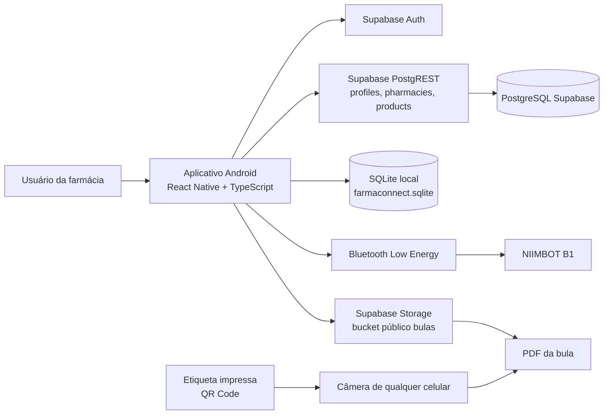
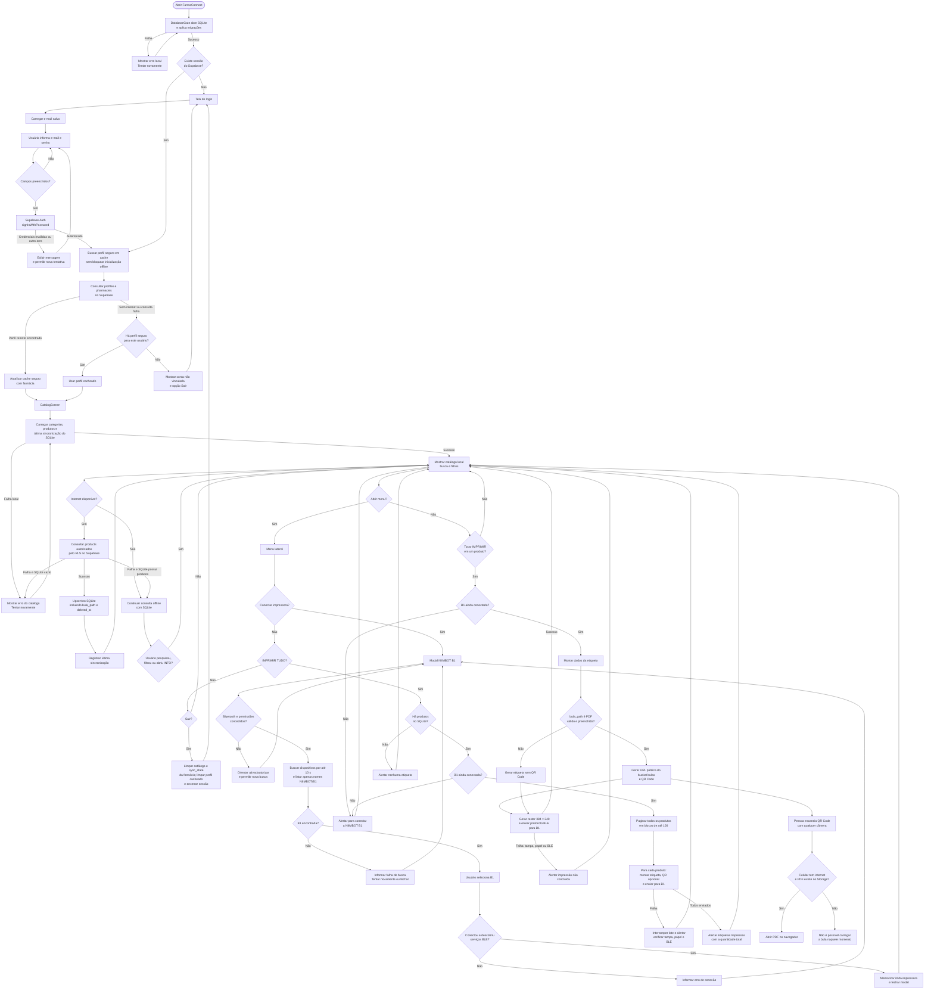

# Documentação End-to-End — FarmaConnect

> Documento técnico e operacional do aplicativo FarmaConnect. Atualizado em 01/10/2026.

## 1. Visão geral

O FarmaConnect é um aplicativo Android para uma farmácia consultar seu catálogo local, mesmo sem internet, e imprimir etiquetas na impressora Bluetooth **NIIMBOT B1**. Os dados oficiais ficam no Supabase e uma cópia por farmácia é mantida no SQLite do aparelho.

Cada produto pode ter uma bula em PDF. O PDF fica no Supabase Storage e o aplicativo armazena somente o seu caminho. Ao imprimir uma etiqueta de um produto com bula, o app gera um QR Code com a URL pública do PDF. A leitura do QR Code abre a bula no navegador de qualquer celular, sem exigir o FarmaConnect instalado.

### Funções disponíveis

- Login com e-mail e senha via Supabase Auth.
- Catálogo isolado por farmácia com busca e filtro por categoria.
- Catálogo offline após a primeira sincronização bem-sucedida.
- Sincronização automática Supabase → SQLite quando houver internet.
- Conexão Bluetooth com impressoras cujo nome anunciado contém `NIIMBOT` ou `B1`.
- Impressão individual e impressão em massa de todos os produtos da farmácia.
- Etiqueta 50 × 30 mm com nome, data, farmácia, EAN, código interno, preço e QR Code opcional de bula.
- Bula PDF pública via QR Code.

## 2. Escopo e limites atuais

O aplicativo é de consulta e impressão. Ele **não edita produtos**, não controla estoque, não faz venda e não envia alterações do SQLite ao Supabase.

A sincronização é unidirecional: o Supabase é a fonte oficial e o SQLite recebe uma cópia local. Os PDFs não são copiados para o aparelho. Portanto, o catálogo pode ser consultado offline, mas a abertura da bula pelo QR Code depende de internet no celular que a escanear.

## 3. Arquitetura



### Componentes principais

| Camada | Tecnologia | Responsabilidade |
| --- | --- | --- |
| Interface móvel | React Native 0.87 + TypeScript | Login, catálogo, menus, modais e feedback ao usuário. |
| Banco offline | `@op-engineering/op-sqlite` | Armazena catálogo e data da última sincronização por farmácia. |
| Backend | Supabase Auth, PostgreSQL e RLS | Autentica o usuário e libera leitura apenas da própria farmácia. |
| Arquivos de bula | Supabase Storage | Guarda PDFs em `bulas`; leitura pública para funcionar pelo QR Code. |
| Impressão | `react-native-ble-plx` + `@slastra/nblib` | Descobre a B1, conecta por BLE e envia o raster da etiqueta. |
| Segredos locais | `react-native-keychain` | Guarda sessão do Supabase, perfil em cache e e-mail lembrado. |

### APIs, frameworks e bibliotecas utilizadas

| Categoria | Tecnologia | Uso no FarmaConnect |
| --- | --- | --- |
| Framework móvel | React Native 0.87.1 | Base do aplicativo Android, componentes de interface, ciclo de vida, permissões e modais. |
| Biblioteca de interface | React 19.2.3 | Componentes funcionais, estado, efeitos e callbacks. |
| Linguagem | TypeScript 6 | Tipagem do domínio, bancos, impressão e telas. |
| Backend/API | `@supabase/supabase-js` 2.117.2 | Cliente para Auth, consulta PostgREST de tabelas e Storage. |
| API de autenticação | Supabase Auth | `getSession`, renovação de sessão, eventos de autenticação e `signInWithPassword`. |
| API de dados | Supabase PostgREST | Leitura de `profiles`, `pharmacies` e `products`, protegida por RLS. |
| API de arquivos | Supabase Storage | Geração da URL pública de PDFs no bucket `bulas`. |
| Banco local | `@op-engineering/op-sqlite` 18.2.5 | Abertura de `farmaconnect.sqlite`, SQL, transações e migrações locais. |
| Conectividade | `@react-native-community/netinfo` 12 | Verifica conexão e inicia a sincronização quando a internet volta. |
| Bluetooth | `react-native-ble-plx` 3.5.1 | Permissões Android, busca BLE, conexão, descoberta de serviços e escrita na NIIMBOT B1. |
| Protocolo de impressão | `@slastra/nblib` 0.3.0 | Handshake, troca de comandos, criação de página raster e envio do trabalho à B1. |
| QR Code | `qrcode-generator` 2.0.4 | Converte a URL pública da bula em módulos do QR Code da etiqueta. |
| Sessão segura | `react-native-keychain` 10 | Protege sessão Supabase e perfil cacheado por meio do Keystore Android. |
| Preferência local | `@react-native-async-storage/async-storage` 3.1.1 | Salva somente o e-mail lembrado na tela de login. |
| Layout seguro | `react-native-safe-area-context` 5.5.2 | Respeita áreas seguras de tela e navegação do Android. |
| Compatibilidade de URL | `react-native-url-polyfill` 4 | Disponibiliza APIs de URL exigidas pelo cliente Supabase no React Native. |
| Testes | Jest 29 + React Test Renderer | Testes de tela, banco, sincronização, rótulo, QR Code e descoberta de impressora. |
| Qualidade | ESLint 8 + TypeScript | Verificação estática e estilo de código. |
| Empacotamento | Metro, Babel, Gradle, Android SDK e JDK 17 | Geração do bundle React Native e do APK Android preview ARM64. |

Não há outras APIs externas de negócio. O aplicativo não integra pagamentos, estoque, mapas, e-mail, WhatsApp ou serviços de terceiros além do Supabase, da pilha Android/Bluetooth e das bibliotecas acima.

## 4. Estrutura do repositório

```text
farmaconnect_web/
├── mobile/                         # Aplicativo Android React Native
│   ├── src/
│   │   ├── auth/                    # E-mail lembrado para o login
│   │   ├── bulas/                   # URL pública do PDF
│   │   ├── components/              # Portas de banco, sessão e impressora
│   │   ├── database/                # SQLite, migrações, demo e repositórios
│   │   ├── labels/                  # Dados semânticos da etiqueta
│   │   ├── printer/                 # BLE, protocolo B1 e raster da etiqueta
│   │   ├── screens/                 # Login e catálogo
│   │   └── supabase/                # Cliente, sessão segura e perfil
│   ├── android/                     # Projeto Android nativo
│   ├── __tests__/                   # Testes Jest
│   └── scripts/android.ps1          # Build, instalação e ADB
├── supabase/
│   ├── migrations/                  # Estrutura e políticas do banco/Storage
│   ├── seed/                        # Catálogo de demonstração
│   └── verification/                # Roteiro de validação manual
├── DOCUMENTACAO_END_TO_END.md       # Este documento
└── MEMORIA_PROJETO.md               # Histórico de decisões e validações
```

## 5. Modelo de dados

### Supabase PostgreSQL

| Tabela | Finalidade | Campos relevantes |
| --- | --- | --- |
| `pharmacies` | Cadastro da farmácia. | `id`, `name`, `created_at`, `updated_at` |
| `profiles` | Vínculo entre `auth.users` e uma farmácia. | `user_id`, `pharmacy_id`, `name` |
| `products` | Catálogo oficial por farmácia. | `id`, `pharmacy_id`, `name`, `category`, `price_cents`, `description`, `manufacturer`, `dosage`, `ean`, `internal_code`, `bula_path`, `updated_at`, `deleted_at` |

Regras relevantes de `products`:

- `price_cents` é inteiro em centavos. Exemplo: `1550` representa `R$ 15,50`.
- `ean`, quando preenchido, deve ter 13 dígitos.
- `internal_code` segue `FC` + seis dígitos, por exemplo `FC000002`.
- `deleted_at` representa exclusão lógica: o registro continua sincronizado, porém não aparece no catálogo local.
- `bula_path` pode ser `null`; quando existe, deve apontar para um PDF válido no bucket `bulas`, sem caminho absoluto ou `..`.

### SQLite local

O arquivo local é `farmaconnect.sqlite`. Ele recebe migrações versionadas até a versão 4 e contém:

| Tabela | Uso |
| --- | --- |
| `products` | Cópia dos produtos da farmácia atual, inclusive `ean`, `internal_code` e `bula_path`, além de campos normalizados para busca. |
| `sync_state` | Data/hora da última sincronização concluída por `pharmacy_id`. |

O SQLite não armazena contas, senhas, tokens administrativos nem PDFs.

### Bulas no Storage

- Bucket: `bulas`.
- Visibilidade: pública somente para leitura.
- Tipo permitido: `application/pdf`.
- Tamanho máximo: 10 MB.
- Exemplo de caminho: `demonstracao/FC000002.pdf`.
- Exemplo de URL produzida: `https://<projeto>.supabase.co/storage/v1/object/public/bulas/demonstracao/FC000002.pdf`.

## 6. Segurança e isolamento

1. O APK inclui apenas `SUPABASE_URL` e `SUPABASE_PUBLISHABLE_KEY`.
2. Uma `service_role`, senha de banco ou token administrativo nunca deve entrar no APK, no `.env` distribuído ou em commits.
3. O Supabase usa RLS:
   - usuário autenticado lê o próprio `profiles`;
   - usuário autenticado lê somente a `pharmacies` ligada ao seu perfil;
   - usuário autenticado lê somente `products` da sua farmácia.
4. O aplicativo não possui política de escrita para `products` nesta fase.
5. Os PDFs são públicos de propósito: o QR Code precisa abrir no navegador de qualquer pessoa. O upload ocorre pelo painel administrativo do Supabase, fora do aplicativo.
6. Sessão e perfil cacheado usam armazenamento seguro do aparelho. No logout, o app remove o perfil cacheado, os produtos locais e o estado de sincronização da farmácia ativa.

## 7. Preparação do ambiente

### Requisitos de desenvolvimento

- Windows com PowerShell.
- Node.js 22.11 ou superior.
- JDK 17.
- Android SDK com `adb` disponível.
- Celular Android físico com depuração USB. O projeto é validado no Galaxy A70 com Android 11; não é necessário emulador.
- Projeto Supabase criado.

### Variáveis locais

Crie `mobile/.env` a partir de `mobile/.env.example`:

```env
SUPABASE_URL=https://seu-projeto.supabase.co
SUPABASE_PUBLISHABLE_KEY=sb_publishable_sua_chave_publica
```

Esse arquivo é ignorado pelo Git. Use somente a chave pública/publicável do Supabase.

### Dependências e validação local

Na pasta `mobile`:

```powershell
npm.cmd ci
npm.cmd run typecheck
npm.cmd run lint
npm.cmd test -- --runInBand
```

## 8. Implantação do Supabase

### 8.1 Criar a estrutura remota

No SQL Editor do Supabase, aplique as migrações na ordem cronológica:

1. `supabase/migrations/20260928000000_initial_schema.sql`
2. `supabase/migrations/20260929000000_product_identifiers.sql`
3. `supabase/migrations/20261001000000_product_bulas.sql`

A primeira cria as tabelas, índices, triggers de `updated_at`, permissões e políticas RLS. A segunda mantém os identificadores de produto. A terceira acrescenta `bula_path` e o bucket `bulas`.

### 8.2 Criar farmácias, usuários e perfis

A criação de usuários e dos vínculos de perfil é administrativa. Para cada usuário:

1. Crie o usuário em **Authentication > Users**.
2. Confirme o e-mail se essa exigência estiver ativada no projeto.
3. Crie ou selecione a farmácia em `public.pharmacies`.
4. Insira um registro em `public.profiles` com o `user_id` do Auth e o `pharmacy_id` correspondente.
5. Cadastre os produtos dessa farmácia em `public.products`.

O perfil é obrigatório para abrir o catálogo. Uma sessão sem perfil remoto nem perfil seguro em cache mostra a mensagem de conta não vinculada e permite sair.

### 8.3 Carregar o catálogo demonstrativo

Execute `supabase/seed/catalogo_demonstracao_por_farmacia.sql` após as migrações. O script faz `upsert` dos produtos demonstrativos e restaura produtos previamente marcados como excluídos.

No catálogo atual, os produtos com bula configurada são Paracetamol, Dipirona Sódica, Vitamina C e Multivitamínico. Shampoo, Protetor Solar, Álcool em Gel, Termômetro, Fralda e Curativo usam `bula_path = null` e não imprimem QR Code.

### 8.4 Enviar PDFs de bula

1. Abra **Storage > bulas** no painel do Supabase.
2. Envie um PDF com o mesmo caminho gravado em `products.bula_path`.
3. Exemplo para Dipirona: `demonstracao/FC000002.pdf`.
4. Mantenha o tipo PDF e o arquivo abaixo de 10 MB.
5. Abra a URL pública em um navegador para confirmar que o arquivo está acessível.

## 9. Fluxograma end-to-end

O diagrama abaixo reúne inicialização, autenticação, uso offline, sincronização, conexão da B1, impressão individual/em massa e QR Code de bula.



## 10. Fluxos operacionais detalhados

### 10.1 Primeiro acesso com internet

1. Abra o app; o SQLite é preparado antes de mostrar a tela de login.
2. Informe e-mail e senha.
3. O Supabase Auth valida a conta.
4. O app encontra o perfil e identifica a farmácia vinculada.
5. O catálogo remoto autorizado pelo RLS é copiado para o SQLite.
6. O catálogo fica disponível para consulta, inclusive em acessos futuros sem internet.

### 10.2 Acesso offline após o primeiro login

1. O Supabase restaura a sessão persistida localmente.
2. O app usa o perfil seguro cacheado sem esperar a consulta de rede.
3. O catálogo aparece pelo SQLite.
4. Sem internet, não há atualização do catálogo; busca, filtros, informações e a etiqueta continuam disponíveis.
5. Caso o produto tenha bula, o QR ainda é impresso, mas a pessoa que escanear precisará de internet para abrir o PDF.

### 10.3 Sincronização do catálogo

A sincronização é iniciada quando a conectividade retorna, quando o app volta ao estado ativo e a cada 15 minutos enquanto está ativo.

- O app busca apenas os produtos liberados pelas políticas RLS.
- Cada item remoto é validado e salvo no SQLite por `id`.
- Alterações em preço, identificação, dados de bula e `deleted_at` substituem a cópia local.
- Produtos com `deleted_at` preenchido permanecem no banco local, porém deixam de ser listados.
- Se a sincronização falhar e já existir catálogo local, a consulta segue funcionando com os dados disponíveis.

### 10.4 Conectar a NIIMBOT B1

1. Abra o menu de três linhas no catálogo.
2. Toque em **Conectar impressora**.
3. Ative o Bluetooth e conceda a permissão solicitada, se necessário.
4. Toque em **Procurar impressora**.
5. A lista é filtrada para exibir somente dispositivos que anunciem `NIIMBOT` ou `B1`; o conteúdo pode ser rolado quando houver muitos dispositivos.
6. Toque na B1 correta. Ao conectar, a tela fecha automaticamente.
7. Toque fora do cartão ou em **Fechar** para cancelar a conexão.

### 10.5 Imprimir uma etiqueta

1. No cartão do produto, toque em **IMPRIMIR**.
2. O app confirma que a B1 permanece conectada.
3. A etiqueta é criada diretamente, sem tela de prévia.
4. Se `bula_path` estiver preenchido e for válido, o QR Code e a legenda vertical `BULA` são incluídos.
5. O raster é enviado por BLE para a B1.
6. Se houver falha, verifique tampa, mídia, proximidade Bluetooth e reconecte a impressora.

### 10.6 Imprimir todas as etiquetas

1. Abra o menu de três linhas.
2. Toque em **IMPRIMIR TUDO**.
3. O app lê todos os produtos ativos da farmácia a partir do SQLite.
4. Imprime uma etiqueta por produto, sequencialmente.
5. Ao terminar, exibe: **Etiquetas Impressas** e **Todas as (quantidade) etiquetas foram impressas.**
6. Em caso de falha, o lote é interrompido e o app informa a necessidade de conferir a impressora.

### 10.7 Bula via QR Code

1. Configure o caminho do PDF em `products.bula_path`.
2. Envie o PDF ao bucket `bulas` com exatamente o mesmo caminho.
3. Sincronize o catálogo com internet.
4. Imprima a etiqueta.
5. Escaneie o QR Code; ele contém a URL pública do PDF.
6. O navegador do celular abre a bula. Não é necessário instalar o aplicativo.

## 11. Etiqueta impressa

A etiqueta normal usa raster de **384 × 240 pontos**, destinado à mídia de **50 × 30 mm** em 203 dpi. Ela contém:

- nome do produto;
- data de impressão;
- nome da farmácia;
- EAN como texto;
- código interno;
- QR Code e a legenda vertical `BULA`, quando houver bula válida;
- `R$`, parte inteira e centavos em escalas distintas para dar destaque ao preço.

Não há código de barras no modelo atual. O EAN continua presente em forma textual.

## 12. Build e instalação do APK

Na pasta `mobile`:

```powershell
npm.cmd run apk:build
npm.cmd run apk:install
```

O APK é produzido em:

```text
mobile/android/app/build/outputs/apk/preview/app-preview.apk
```

Para conferir os aparelhos conectados:

```powershell
npm.cmd run android:devices
```

## 13. Testes e verificação

| Comando | O que valida |
| --- | --- |
| `npm.cmd run typecheck` | Tipos TypeScript do app e dos testes. |
| `npm.cmd run lint` | Regras ESLint. |
| `npm.cmd test -- --runInBand` | Fluxos de app, SQLite, login lembrado, sincronização, QR/bulas, rótulo e descoberta da B1. |
| `npm.cmd run apk:build` | Compilação do APK preview ARM64. |
| `npm.cmd run apk:install` | Instalação e abertura no Android físico conectado. |

### Roteiro recomendado de homologação

1. Validar login com uma conta vinculada a uma farmácia.
2. Confirmar que o catálogo inicial sincroniza.
3. Desativar a internet e confirmar busca/filtros no catálogo local.
4. Atualizar um produto no Supabase, restaurar a internet e confirmar a atualização no app.
5. Confirmar que um produto de outra farmácia não aparece.
6. Conectar a NIIMBOT B1 e imprimir uma etiqueta sem bula.
7. Imprimir Dipirona ou outro produto com bula, escanear o QR e abrir o PDF em outro celular.
8. Executar **IMPRIMIR TUDO** e conferir a mensagem final com a quantidade.
9. Sair e entrar novamente; confirmar que o catálogo local da conta anterior não é apresentado para outra farmácia.

## 14. Operação e manutenção

### Adicionar ou trocar uma bula

1. Envie o novo PDF ao bucket `bulas` pelo painel administrativo.
2. Atualize `products.bula_path` para o caminho do arquivo, ou `null` para remover o QR Code.
3. Aguarde a sincronização automática ou reabra o app com internet.
4. Imprima uma etiqueta de teste e escaneie o QR Code.

### Atualizar um produto

Atualize o produto administrativamente no Supabase. A trigger mantém `updated_at` atualizado. O app recebe a alteração na próxima sincronização e regrava a cópia SQLite.

### Remover um produto do catálogo

Preencha `deleted_at` no Supabase em vez de apagar fisicamente o produto. O app sincroniza o registro e o oculta da lista local.

### Se a impressora não aparecer

- Ligue a B1 e mantenha-a próxima ao celular.
- Confirme o Bluetooth ativo.
- Conceda as permissões de Bluetooth solicitadas pelo Android.
- Toque em **Procurar impressora** outra vez.
- A lista aceita rolagem e filtra dispositivos para NIIMBOT/B1.

## 15. Arquivos de referência

- [Aplicativo principal](mobile/App.tsx)
- [Autenticação e perfil offline](mobile/src/components/AuthGate.tsx)
- [Catálogo, sincronização e impressão](mobile/src/screens/CatalogScreen.tsx)
- [Conexão da NIIMBOT B1](mobile/src/components/PrinterSetup.tsx)
- [Raster da etiqueta](mobile/src/printer/normalLabelRaster.ts)
- [Repositório SQLite de produtos](mobile/src/database/repositories/products.ts)
- [Migrações SQLite](mobile/src/database/migrations.ts)
- [Schema e RLS do Supabase](supabase/migrations/20260928000000_initial_schema.sql)
- [Bulas e bucket Storage](supabase/migrations/20261001000000_product_bulas.sql)
- [Seed de demonstração](supabase/seed/catalogo_demonstracao_por_farmacia.sql)
