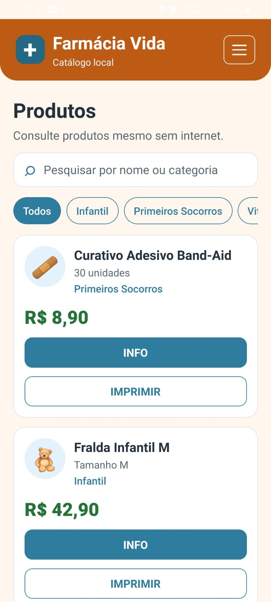
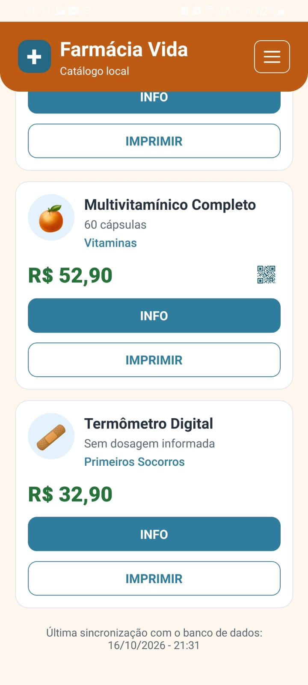
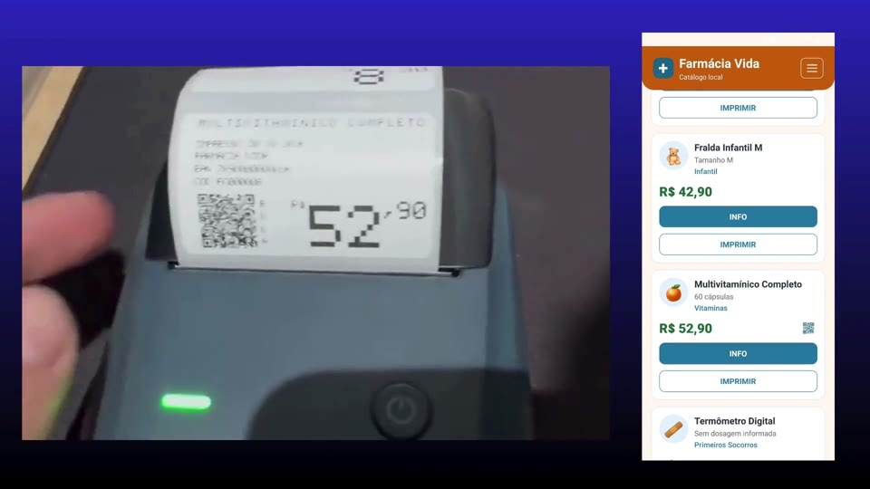
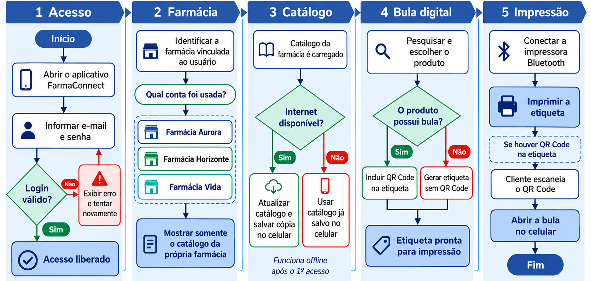
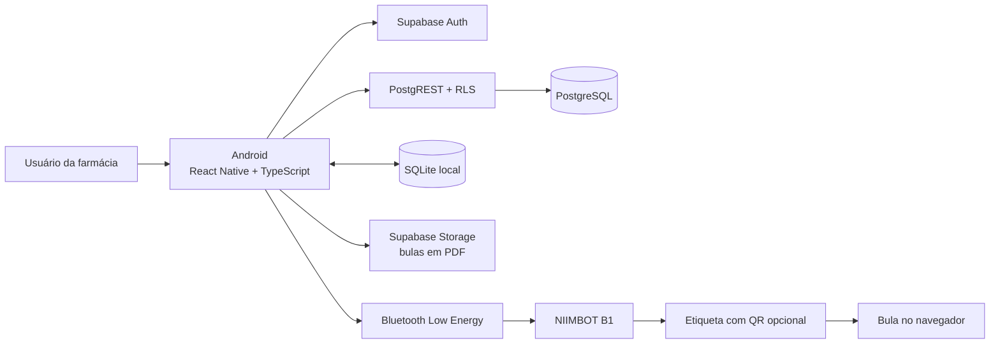

# FarmaConnect

[](https://reactnative.dev/)
[](https://www.typescriptlang.org/)
[](https://developer.android.com/)
[](https://supabase.com/)
[](#qualidade-e-testes)
[](https://github.com/eduardoabou/FarmaConnect/actions/workflows/ci.yml)

Aplicativo Android para **consulta de catálogos farmacêuticos armazenados localmente** e **impressão de etiquetas térmicas na NIIMBOT B1**. O FarmaConnect combina autenticação e dados centralizados no Supabase com uma cópia operacional em SQLite, permitindo consultar o catálogo e imprimir etiquetas sem conexão após a primeira sincronização bem-sucedida.

> Projeto acadêmico desenvolvido como Trabalho de Conclusão de Curso em Engenharia da Computação.

## Problema e proposta

A atualização manual de etiquetas pode exigir consulta em sistemas separados, deslocamento até um computador e repetição de informações. O FarmaConnect concentra a consulta do catálogo e a impressão no celular, mantendo o Supabase como fonte oficial e o SQLite como armazenamento local para uso após a sincronização.

A aplicação foi construída para um fluxo específico: **autenticar, sincronizar o catálogo autorizado, localizar produtos e imprimir etiquetas individuais ou em massa**. Ela não realiza vendas, pagamentos, controle de estoque ou edição administrativa de produtos.

## Aplicativo em funcionamento

<p align="center">
  
  &nbsp;&nbsp;
  
</p>

<p align="center"><em>À esquerda: catálogo, busca e filtros por categoria. À direita: produtos, indicador de QR Code e última sincronização.</em></p>

### Demonstração em vídeo

<a href="docs/videos/demonstracao-farmaconnect.mp4">
  
</a>

**[▶ Assistir à demonstração (1 min 31 s)](docs/videos/demonstracao-farmaconnect.mp4)**

O vídeo apresenta o aplicativo em uso com a impressora **NIIMBOT B1**, incluindo a conexão e a impressão de uma etiqueta física.

## Funcionalidades implementadas

- Autenticação por e-mail e senha com Supabase Auth.
- Isolamento do catálogo por farmácia com Row Level Security (RLS).
- Sincronização unidirecional do Supabase para o SQLite.
- Consulta offline após a primeira sincronização bem-sucedida.
- Busca por nome e filtro por categoria.
- Descoberta e conexão Bluetooth Low Energy com a NIIMBOT B1.
- Impressão individual e impressão em massa.
- Etiqueta térmica de 50 × 30 mm com nome, data, farmácia, EAN textual, código interno e preço.
- QR Code opcional para abrir a bula em PDF no navegador, sem exigir o aplicativo no celular leitor.
- Limpeza dos dados locais da farmácia ativa ao encerrar a sessão.

## Fluxo de funcionamento

O fluxo abaixo resume a jornada apresentada no TCC: autenticação, identificação da farmácia, acesso ao catálogo, decisão sobre incluir a bula digital por QR Code e impressão da etiqueta.



O catálogo é armazenado localmente após a sincronização; o acesso à bula pelo QR Code depende da conexão do aparelho que realiza a leitura.

## Arquitetura



O Supabase é a fonte oficial. O aplicativo autenticado recebe somente os registros liberados pelas políticas RLS e os grava no SQLite usando o `pharmacy_id` da conta. A sincronização não envia alterações locais para a nuvem. No logout, o catálogo e o estado de sincronização da farmácia ativa são removidos do aparelho.

Detalhes adicionais estão em:

- [Arquitetura e fluxos](docs/ARCHITECTURE.md)
- [Segurança e privacidade](docs/SECURITY.md)
- [Documentação técnica completa](DOCUMENTACAO_END_TO_END.md)

## Tecnologias principais

| Área | Tecnologia | Responsabilidade |
| --- | --- | --- |
| Aplicativo | React Native 0.87.1, React 19.2.3 e TypeScript 6 | Interface, ciclo de vida e regras do cliente Android |
| Backend | Supabase Auth, PostgreSQL, PostgREST e RLS | Autenticação, catálogo oficial e isolamento por farmácia |
| Dados offline | SQLite com `@op-engineering/op-sqlite` | Catálogo local e estado de sincronização |
| Arquivos | Supabase Storage | PDFs públicos de bula acessados pelo QR Code |
| Bluetooth | `react-native-ble-plx` | Busca, conexão e comunicação BLE |
| Impressão | `@slastra/nblib` | Protocolo e trabalho de impressão da NIIMBOT B1 |
| QR Code | `qrcode-generator` | Codificação da URL pública da bula |
| Armazenamento seguro | `react-native-keychain` | Sessão Supabase e perfil local protegido |
| Qualidade | Jest, ESLint e TypeScript | Testes e análise estática |

## Estrutura do repositório

```text
FarmaConnect/
├── mobile/                    # Aplicativo React Native e projeto Android
│   ├── src/                   # Domínio, telas, SQLite, Supabase e impressão
│   ├── __tests__/             # Testes Jest
│   ├── android/               # Código e configuração Android nativa
│   └── scripts/android.ps1    # Build, instalação e consulta ADB
├── supabase/
│   ├── migrations/            # Tabelas, índices, RLS, Storage e políticas
│   ├── seed/                  # Catálogo demonstrativo
│   └── verification/          # Roteiro SQL de verificação manual
├── docs/                      # Documentação e materiais de apresentação
│   ├── images/               # Capturas de tela, fluxograma e capa do vídeo
│   └── videos/               # Vídeo demonstrativo do aplicativo e impressão
└── README.md
```

## Requisitos

- Windows com PowerShell.
- Node.js 22.11 ou superior e npm.
- JDK 17.
- Android SDK e `adb` configurados.
- Um projeto Supabase.
- Celular Android físico com API 24 ou superior.
- NIIMBOT B1 para validar a impressão física.

O desenvolvimento e a homologação registrados no projeto foram realizados em um **Samsung Galaxy A70 com Android 11**, sem emulador.

## Configuração local

1. Clone o repositório e instale as dependências:

   ```powershell
   git clone https://github.com/eduardoabou/FarmaConnect.git
   cd FarmaConnect\mobile
   npm.cmd ci
   ```

2. Crie a configuração local a partir do exemplo:

   ```powershell
   Copy-Item .env.example .env
   ```

3. Preencha apenas as configurações públicas do cliente:

   ```env
   SUPABASE_URL=https://seu-projeto.supabase.co
   SUPABASE_PUBLISHABLE_KEY=sb_publishable_substitua_esta_chave
   ```

   Nunca adicione `service_role`, senha do banco ou credenciais administrativas ao aplicativo.

4. Aplique as migrações do diretório [`supabase/migrations`](supabase/migrations) pelo SQL Editor ou pela Supabase CLI, respeitando a ordem dos nomes dos arquivos. O catálogo de demonstração está em [`supabase/seed`](supabase/seed).

## Executar no Android

Com um único celular autorizado por USB:

```powershell
cd mobile
npm.cmd run android:devices
```

Para desenvolvimento com Metro, use dois terminais:

```powershell
# Terminal 1
npm.cmd start

# Terminal 2
npm.cmd run android
```

Para gerar o APK preview independente do Metro:

```powershell
npm.cmd run apk:build
```

O artefato é criado em:

```text
mobile/android/app/build/outputs/apk/preview/app-preview.apk
```

Para instalar um APK preview já compilado:

```powershell
npm.cmd run apk:install
```

## Qualidade e testes

Execute na pasta `mobile`:

```powershell
npm.cmd run typecheck
npm.cmd run lint
npm.cmd test -- --runInBand
```

Verificação local realizada em **13 de novembro de 2026**:

| Verificação | Resultado |
| --- | --- |
| TypeScript | Aprovado |
| ESLint | Aprovado |
| Jest | 10 suítes e 17 testes aprovados; 0 falhas |

Os testes cobrem inicialização, catálogo, SQLite, estado de sincronização, e-mail lembrado, URL da bula, composição/raster da etiqueta e filtro de descoberta NIIMBOT. A comunicação e a impressão física também exigem homologação no aparelho e na impressora.

### Integração contínua

O workflow [CI](https://github.com/eduardoabou/FarmaConnect/actions/workflows/ci.yml) executa automaticamente `npm ci`, a verificação do TypeScript, o ESLint e os testes Jest em cada push para a `main` e em Pull Requests direcionados a ela. Essa automação não utiliza credenciais reais do Supabase, não gera APK e não realiza deployment.

## Segurança

- O `.env` real não é versionado.
- O APK recebe somente URL e chave publicável do Supabase.
- O acesso remoto é limitado por autenticação e políticas RLS.
- Sessão e perfil em cache usam o armazenamento seguro do Android.
- O SQLite fica no armazenamento privado do aplicativo; ele não usa criptografia própria nesta versão.
- O bucket de bulas é público somente para permitir que o QR Code abra o PDF sem autenticação.
- A chave de depuração Android não deve ser reutilizada para uma publicação de produção.

Consulte [docs/SECURITY.md](docs/SECURITY.md) antes de publicar ou distribuir o APK.

## Limitações conhecidas

- Aplicativo concentrado na plataforma Android.
- Impressão homologada para a NIIMBOT B1.
- O primeiro login e a primeira sincronização exigem internet.
- A leitura da bula pelo QR Code depende de internet no celular leitor.
- O banco SQLite local não utiliza SQLCipher.
- A variante de produção ainda exige uma chave de assinatura própria.

## Equipe e contexto acadêmico

O FarmaConnect foi desenvolvido em equipe como **Trabalho de Conclusão de Curso em Engenharia da Computação** pelos integrantes:

- **Eduardo Abou Antoun**
- **Murilo Blumer Rios**

O projeto é apresentado como uma realização coletiva. Este repositório não atribui módulos ou contribuições individuais sem documentação específica que as comprove.

## Licença

Este repositório não possui licença definida neste momento.
